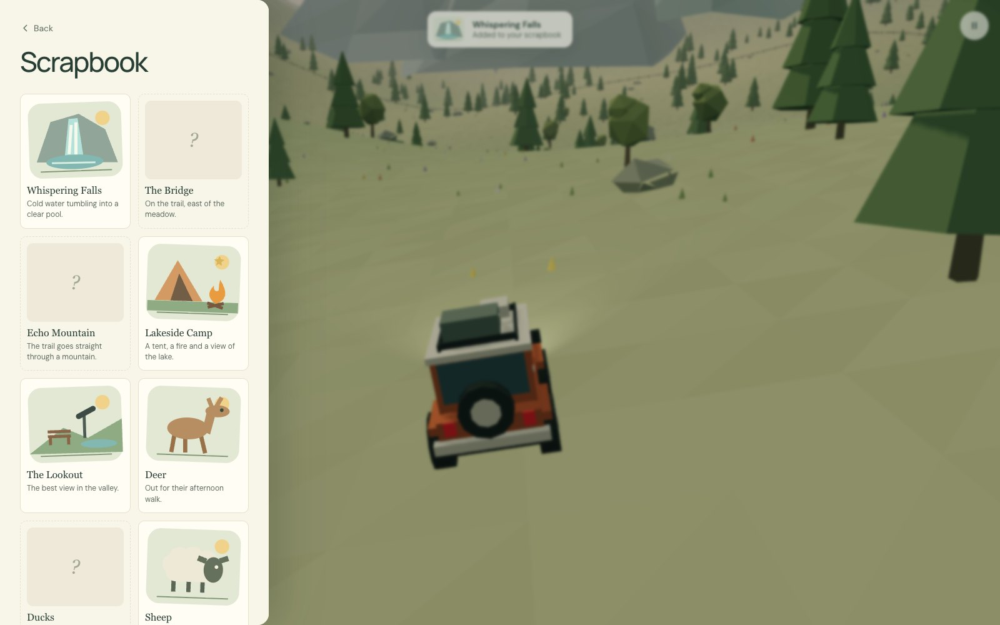

# Nowhere to Be

A relaxed low-poly driving game that runs in the browser. Take a little off-roader around a mountain valley at your own pace. There are no timers, no score and nothing to win. I made it for my son and me to explore together.


<p>
  
  
</p>
<p>
  
  
</p>

## Controls


|        | Keyboard            | Phone or tablet                    |
| ------ | ------------------- | ---------------------------------- |
| Drive  | `W A S D` or arrows | Pedals (right) and steering (left) |
| Steer  | `A` `D` or `←` `→`  | Arrows, or tilt the device         |
| Brake  | `Space`             | Down pedal (hold to reverse)       |
| Horn   | `H`                 | Horn button above the pedals       |
| Cruise | `E`                 | In the menu                        |
| Pause  | `Esc`               | ❚❚ button, top right               |

## Playing on a phone


The game works on phones and tablets with on-screen pedals. You can also steer by turning the device like a steering wheel:

1. Open the game on your phone (see below).
2. Tap ❚❚, turn on **Tilt to steer**, and allow motion access.
3. Hold the phone like a wheel and turn it. **Re-centre tilt** resets the straight-ahead position.

Browsers only allow motion sensors on secure (HTTPS) pages, so tilt needs the game served over HTTPS (any static host works). A local `http://192.168…` address supports the touch pedals only.

To play on your phone from your own computer, run `npm run dev` and open the **Network** address it prints, with both devices on the same Wi-Fi.

## Things to find

- **Places and animals.** Driving past them adds stickers to your scrapbook, which you'll find in the pause menu.
- **Garden gnomes.** Ten are hidden around the valley, some of them far off the trail. Finding them all unlocks something for the car.
- **A few secrets.** Try the horn in the tunnel, near the animals and at passing cars. Keep an eye on the snow, too.

Progress is saved in your browser.

## How it's made

Everything is generated in code with [Three.js](https://threejs.org) and Web Audio. There are no model, texture or sound files.

- **Terrain:** a height field that is fine on the valley floor and coarse under the distant peaks. The trail is levelled across its width, the creek is carved into it, and buildings sit on flattened pads, so nothing floats or sinks.
- **Driving:** an arcade model with real velocity, tyre grip per surface, hill slowdown and soft collisions. Each tyre is settled onto the terrain triangle beneath it.
- **Camera:** a spring arm that pulls in when rock comes between it and the car, so the tunnel and cliffs never swallow the view.
- **Performance:** cheap Lambert materials, merged and instanced meshes, one shadow-casting light, a 60 fps cap, no rendering while paused, and a resolution that adapts to the device.

```
src/
  core/       driving physics, collisions, suspension, camera, audio, save data
  input/      keyboard, touch and tilt steering
  world/      layout, terrain, scenery, landmarks, wildlife, weather, secrets
  vehicles/   the player's car and the other travellers
  ui/         title screen, pause menu, scrapbook, styles
```

## Development

Requires Node.js 20.19 or newer.

```sh
npm install
npm run dev            # start the game locally
npm test               # unit tests: physics, terrain, saves, tilt, a full lap of the trail
npm run test:browser   # end-to-end smoke test in Chrome
npm run screenshots    # regenerate the images in docs/
npm run build          # static build in dist/, ready for any static host
```

CI runs the formatting check, the unit tests and a build on every push.
