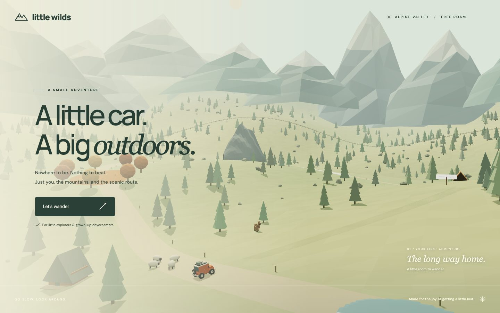
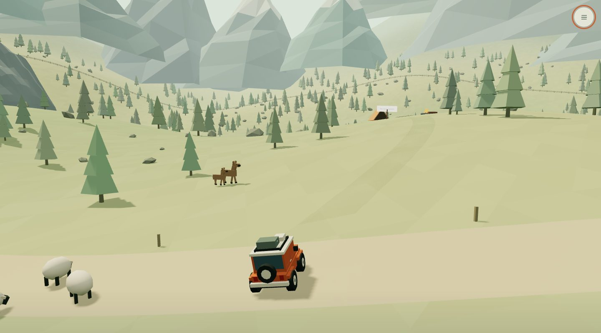
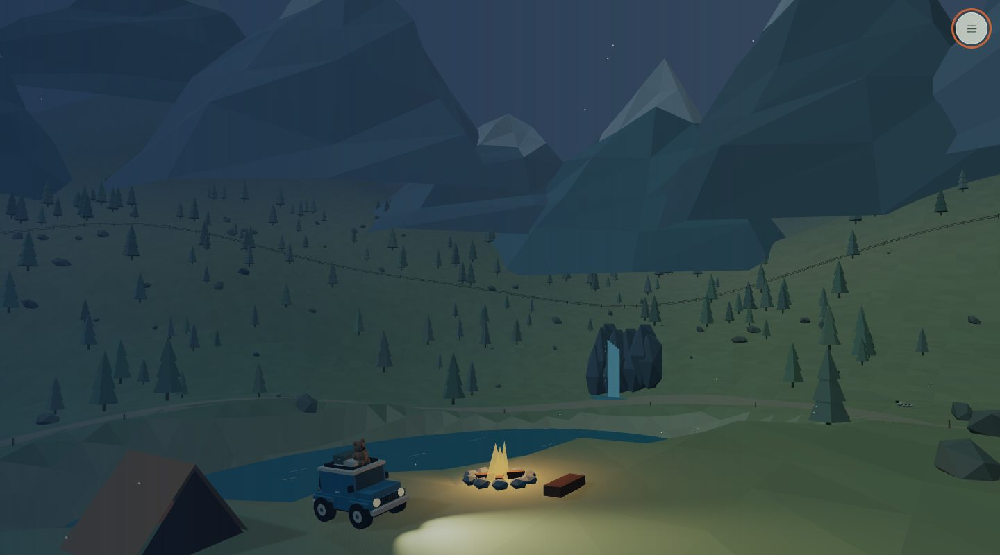
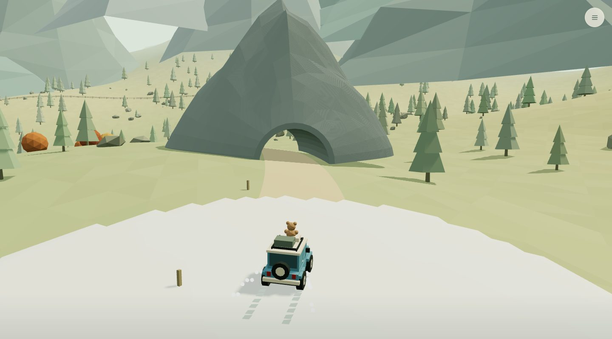

# Little Wilds

A calm, low-poly driving game that runs in the browser. I made it for my son and me to take turns exploring a mountain valley in a little off-roader. There are no installs, accounts, timers or scores, and nothing to win.



<p>
  
  
  
</p>

Follow the trail to a bridge, a waterfall, a mountain tunnel and a hidden campsite, collecting stickers for a scrapbook along the way. Sheep, deer, ducks and a rabbit live in the valley, and a five-minute sky cycle brings sunset, stars and passing rain. Drive with the keyboard, the on-screen touch buttons, or by tilting a phone or tablet like a steering wheel.

Everything you see and hear is generated in code with Three.js and Web Audio. There are no model, texture or sound files.

## Run

Requires Node.js 20.19+ or 22.12+.

```sh
npm install
npm run dev
```

Open the local URL Vite prints. For a tablet or phone on the same Wi-Fi, open the **Network** URL printed by Vite. The computer must keep the server running; its firewall must allow the connection. A plain HTTP Network URL supports touch controls; tilt steering on iPhone/iPad requires a trusted HTTPS game URL (see below).

```sh
npm test
npm run build
npm run preview
```

The `dist/` folder can be served by any static web host. No backend, accounts, API keys, or paid services. The game bundles Three.js locally. Optional Google Fonts fall back to installed fonts without blocking play.

## Controls

While driving, the screen shows just the **menu button in the upper-right corner** and the touch driving buttons on phones/tablets. Open the menu for Little explorer (cruise control), tilt steering, recentering, scrapbook, car choices, horn, sound, sky, home, and nearby campsite actions. Opening the menu pauses the car; **Back to the fresh air** closes it and resumes. Scrapbook and car subpages return to the menu when closed.

Discoveries are collected silently. There are no pop-up tips, hover tooltips, distance hints, or speed/distance overlays. Help is available inside the menu under **How to play**. Camp nights also stay clear of overlays; use the menu to start the next outing.

- **Arrow keys / WASD:** accelerate, reverse, and steer.
- **Space:** brake.
- **R / Home:** return to the meadow, or to your campsite after your first camp night.
- **H / Beep:** play your friendly horn. Choose a little beep, bicycle bell, quack, or twinkle in **My car**. Playing a horn turns sound on.
- **B / Scrapbook:** browse eight illustrated place and animal stickers, with hints for discoveries still to come.
- **C / My car:** choose from five colours and add a flag or teddy bear.
- **Esc:** pause; press again to resume.
- **Little explorer:** gentle automatic forward driving; only steering is needed. Brake overrides it.
- **Tilt steering:** hold a phone or tablet like a steering wheel, open the menu and tap **Tilt steering**, and allow motion access. The first reading centers your grip. Turn gently left/right in portrait or either landscape direction. **Center steering** resets the neutral position. Use the pedals, or Little explorer for automatic forward driving.
- **Touch:** hold the large arrow buttons; multiple fingers work together. The square button brakes.
- **Sky (in the menu):** preview sunset, night, rain, daylight, or return to the automatic sky cycle. Headlights turn on automatically.
- **Sound (in the menu):** optional soft engine and wind sounds, off initially.

The car stops automatically when you release the accelerator, cannot flip, and stays out of deep water and beyond the valley boundary. Trees and rocks gently block and deflect the car. Leaving the tab pauses the game. There is no timer, damage, objective, or score. Scrapbook discoveries, car colour, decoration, horn choice, and your campsite starting point save locally in this browser. If browser storage is unavailable, they remain usable for the current outing.

Browser smoke tests use an installed Google Chrome and a running development server:

```sh
npm run test:browser
npm run test:adventures
npm run test:tilt
npm run test:quiet
```

These exercise keyboard input, simultaneous touch controls, pause/resume, sky presets, headlights, wildlife, discoveries, customisation, save/reload, terrain effects, and campsite nights, and save screenshots in `artifacts/`. Mobile layouts and touch are emulated; physical-device performance still needs playtesting.

## Tilt steering on iPhone and iPad

Open the game over **trusted HTTPS**, hold the screen comfortably upright (or angled toward you), and open the menu and tap **Tilt steering**. On Safari, approve the motion/orientation permission prompt. A plain `http://192.168…` Wi-Fi address cannot provide these sensor permissions. `localhost` is a development exception on the computer running the browser; it does not make the computer's HTTP LAN address secure on your phone. Serve `dist/` through an HTTPS host, or use a local HTTPS certificate trusted by your device.

The wheel has a small dead zone, smooth proportional steering, and full steering at about 30 degrees. Recenter whenever you change your grip; changing screen orientation also centers the next reading. Existing arrow buttons and keyboard steering override tilt while held. Motion starts off each visit, so the game never requests permission automatically. No motion data is saved or sent anywhere.

If the screen is lying flat, tilt pauses acceleration until it is raised enough to read a reliable wheel angle. Permission denial, unsupported sensors, and absent readings show a message and retain the arrow controls. Turning tilt off returns to the original controls. The tilt browser test simulates sensor readings and permission outcomes alongside actual touch events; physical iPhone/iPad feel and Safari's native permission dialog still need on-device playtesting.

Browser requirements: [MDN device-orientation permission documentation](https://developer.mozilla.org/en-US/docs/Web/API/DeviceOrientationEvent/requestPermission_static). Screen-relative steering follows the [W3C orientation rotation matrix](https://www.w3.org/TR/orientation-event/#worked-example).

## Little things to discover

Follow the trail east to a wooden bridge, around the lake to Whispering Falls, and west through Echo Mountain. The whole trail stays on land. A small spur from the meadow leads to the hidden campsite on the southwest shore. Near camp, release the accelerator (or hold brake in Little explorer mode), then open the menu and choose **Park & watch the stars**. **Start the next outing** brings a fresh morning. Future visits start at that camp.

Drive through the shallow puddles near the southern trail, crunchy autumn leaves in the west, and snow near the mountain. Snow retains the latest 6,000 tire impressions for the current session; marks stay when you drive away and return. Terrain sounds follow the sound toggle. There is no score or requirement to collect every sticker.

## Structure

- `src/main.js` — game loop, follow camera, UI, keyboard and pointer input.
- `src/tilt.js` — optional sensor permission, screen-relative wheel angle, calibration, and steering smoothing.
- `src/controls.js` — saved control preferences (cruise speed, tilt).
- `src/driving.js` — renderer-independent driving and collision rules.
- `src/terrain.js` — deterministic terrain, shared triangle interpolation, trail and spawn.
- `src/world.js` — procedural landscape, instanced vegetation, lake and cabin.
- `src/car.js` — original procedural off-roader model.
- `src/suspension.js` — four-wheel ground contact, terrain pitch/roll, independent suspension.
- `src/atmosphere.js` — day/night cycle, weather, stars, fireflies, headlights.
- `src/habitats.js` — where the deer, ducks and rabbit live and the routes they walk.
- `src/wildlife.js` — animal models and their walking, grazing and burrow animations.
- `src/boundaries.js` — fence marking the edge of the valley.
- `src/audio.js` — optional Web Audio engine, wind, surface sounds, and four friendly horns.
- `src/discoveries.js` — landmark coordinates, bridge contact surface, and saved journal.
- `src/landmarks.js` — bridge, mountain tunnel, waterfall, signs, camp, and fire.
- `src/surfaces.js` — puddles, leaves, snow, particles, and tire tracks.
- `src/stickers.js` — original illustrated scrapbook stickers.
- `src/style.css` — responsive game interface.
- `tests/driving.test.js` — driving, rescue, collision, boundary and terrain checks.

This is a deliberately small first prototype: one local player, one landscape, arcade driving, and browser-local saved discoveries. WebGL is required; keyboard and touch are supported.
